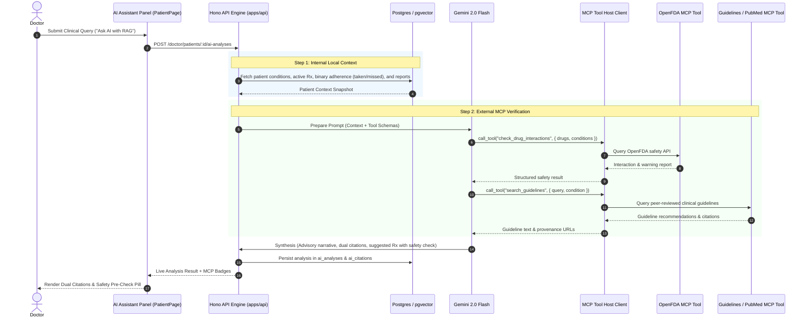

# Design: Hybrid AI Assistant with MCP External Medical Tools

## Context
See [proposal.md](file:///d:/meg_RAG_From_figma/openspec/changes/hybrid-ai-assistant-mcp/proposal.md). Building upon Phase 1 ([real-data-doctor-patient-tabs](file:///d:/meg_RAG_From_figma/openspec/changes/real-data-doctor-patient-tabs/proposal.md)), this design defines the hybrid architecture connecting the backend RAG pipeline in `apps/api` to external Model Context Protocol (MCP) servers (OpenFDA and clinical guidelines) for real-time pharmacology and evidence verification.

## Architecture & Data Flow

---

## Technical Decisions

### 1. Model Context Protocol (MCP) as the External Bridge
* **Decision:** Connect `apps/api` to standardized MCP servers using JSON-RPC client wrappers instead of hardcoding custom one-off HTTP requests for every external medical source.
* **Rationale:** MCP provides standardized tool discovery, schema validation, and error envelopes. It decouples MedNova from provider-specific API changes.

### 2. Dual-Tier Evidence Classification
* **Decision:** Citations in `ai_citations` will carry a `sourceTier` enum:
  * `"patient_record"` (uploaded labs, clinic notes)
  * `"external_mcp"` (FDA drug database, ADA/AHA clinical guidelines)
* **Rationale:** Doctors must immediately distinguish what came from the patient's personal file versus what came from external medical literature.

### 3. Graceful Timeout & Offline Fallback
* **Decision:** External MCP tool calls have a hard timeout (maximum 2.5 seconds).
* **Rationale:** Clinical workflows cannot freeze if an external FDA server is experiencing downtime. If the MCP tool times out, the local analysis finishes and marks the safety pill as *"External interaction check unavailable — manual verification required."*

---

## Risks & Trade-offs
- **[Risk] Latency from external calls** → *Mitigation:* Bounded timeouts and parallel execution of local context retrieval and MCP guideline searches.
- **[Risk] External API breaking changes** → *Mitigation:* MCP tool schemas validate input/output payloads, logging errors safely without breaking UI rendering.
