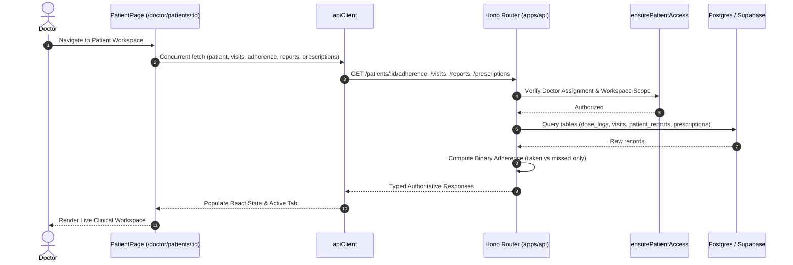

# Design: Real Data Integration for Doctor Patient Clinical Tabs

## Context
See [proposal.md](file:///d:/meg_RAG_From_figma/openspec/changes/real-data-doctor-patient-tabs/proposal.md). Currently, `PatientPage.tsx` loads patient profile, visits, reports, and prescriptions via `api`, but omits adherence, leaving the Overview and Adherence tabs bound to static demo constants (`DEMO_ADHERENCE`, `DEMO_SPARKLINE`, `DEMO_AI_ANALYSIS`). Furthermore, adherence counts previously retained legacy `late` and `skipped` categories. This design establishes a unified server-authoritative architecture for all 6 tabs with a strict binary adherence model (`taken` vs `missed`).

## Data Flow Architecture

---

## Detailed Tab Architecture: 6 Specialized Clinical Tabs

### 1. Overview Tab
* **Purpose:** High-level executive clinical snapshot of the patient.
* **How It Gets Data:**
  * Dispatches `Promise.all` on mount:
    * `api.patients.get(patientId)`
    * `api.patients.getAdherence(patientId)`
    * `api.patients.getPrescriptions(patientId)`
* **How It Processes Data:**
  * Derives `score` directly from `adherence.score` (0–100%).
  * Renders `adherence.takenCount` and `adherence.missedCount` (strictly binary; eliminates `late` and `skipped`).
  * Generates the rolling adherence trend badge from `adherence.trend` (`"up"` | `"down"` | `"stable"`).
  * Passes `adherence.sparkline` (chronological `{ date, value }[]`) to `<ScoreTrendChart />` (replacing `DEMO_SPARKLINE`).
* **How It Updates Data:**
  * Refreshes when child actions occur (e.g. prescription approved or updated).
* **Routing & State:**
  * Active when `activeTab === "Overview"`. Route path is `/doctor/patients/:patientId`.
* **Error Checking & Fallbacks:**
  * If adherence is unavailable, displays a non-blocking card alert with a "Retry Adherence" CTA while keeping demographics and prescriptions visible.
  * If the patient is completely new with no logged doses, displays an "Awaiting initial dose logging" empty state instead of 0%.

---

### 2. Visits Tab
* **Purpose:** Longitudinal clinical encounter history and consultation timeline.
* **How It Gets Data:**
  * `api.patients.getVisits(patientId)` queries `visits` table filtered by `patient_id` and ordered by `visit_date DESC`.
* **How It Processes Data:**
  * Maps encounters to timeline cards with expandable sections for clinical notes, symptom tags, treatment plans, and outcomes.
  * Automatically tags the most recent encounter with a "Latest" badge.
* **How It Updates Data:**
  * Read-only view in the patient workspace; future encounter additions trigger refetching.
* **Routing & State:**
  * Active when `activeTab === "Visits"`. Collapsed/expanded visit state held in `expandedVisitId`.
* **Error Checking & Fallbacks:**
  * Empty state: Displays a "No recorded clinical visits" card with an option to schedule an encounter.
  * Error state: Shows tab-level recoverable error banner with a manual retry button.

---

### 3. Adherence Tab
* **Purpose:** Deep-dive medication regimen adherence analysis and pattern detection.
* **How It Gets Data:**
  * `GET /patients/:id/adherence` reads the last 90 days of `dose_logs` joined with `dose_schedules`.
* **How It Processes Data:**
  * **Strict Binary Rule:** Filters out `late` and `skipped`. Counts are purely:
    * `takenCount = logs.filter(l => l.status === "taken").length`
    * `missedCount = logs.filter(l => l.status === "missed").length`
    * $\text{score} = \frac{\text{takenCount}}{\text{takenCount} + \text{missedCount}} \times 100$
  * **Heatmap Grid:** Transforms daily logs into `{ date: string, status: "taken" | "missed" }[]` passed to `<DoseHeatmap />`.
  * **AI Pattern Analysis:** Loads persisted analysis from `ai_analyses` or escalation records (`rootCause`, `severity`, `confidence`, `explanation`, `modelVersion`).
* **How It Updates Data:**
  * Recalculated dynamically on the server whenever dose logs are recorded or prescription changes alter the schedules.
* **Routing & State:**
  * Active when `activeTab === "Adherence"`.
* **Error Checking & Fallbacks:**
  * If no dose logs exist, renders a friendly "No doses recorded in the last 90 days" empty state.
  * If AI root cause has not been analyzed yet, shows an advisory note: "No adherence escalation detected. Regular monitoring active."

---

### 4. Reports Tab
* **Purpose:** Management and review of patient-uploaded medical records, labs, and radiology reports.
* **How It Gets Data:**
  * `api.reports.list(patientId)` queries `patient_reports` table for metadata, category, and RAG indexing status.
* **How It Processes Data:**
  * Classifies documents by status (`"shared"` awaiting review vs `"reviewed"`) and indexing state (`"ready"`, `"indexing"`, `"failed"`).
* **How It Updates Data:**
  * **Mark as Reviewed:** Calls `POST /reports/:id/review` which updates the database record and changes the UI badge to "Reviewed".
  * **Retry Indexing:** Calls `POST /reports/:id/reindex` which triggers the vector embedding worker.
* **Routing & State:**
  * Active when `activeTab === "Reports"`.
* **Error Checking & Fallbacks:**
  * If storage signed URL generation fails, warns the doctor with an actionable error toast without crashing the list.
  * Displays "No patient-uploaded reports" empty state if the patient has not submitted files.

---

### 5. AI Assistant Tab
* **Purpose:** Clinical Decision Support grounded in verified patient medical evidence (RAG).
* **How It Gets Data:**
  * Gathers real patient context from current state: conditions, active prescriptions, authoritative adherence score (binary), and count of indexed reports.
* **How It Processes Data:**
  * Submits clinical question via `POST /doctor/patients/:patientId/ai-analyses`.
  * RAG engine performs similarity search over indexed reports and clinical guidelines, queries Gemini model, and returns:
    * Clinical reasoning narrative with evidence citations.
    * Structured medication suggestion array (`name`, `strength`, `frequency`, `duration`, `instructions`).
* **How It Updates Data:**
  * Persists analysis and citations in `ai_analyses` and `ai_citations`.
  * **Approval Flow:** When the doctor reviews and clicks "Confirm & Approve", calls `api.prescriptions.approve(...)` which writes canonical prescription records into `prescriptions` and enqueues schedule generation.
* **Routing & State:**
  * Active when `activeTab === "AI Assistant"`. Polling hook monitors async RAG completion.
* **Error Checking & Fallbacks:**
  * Displays model version, confidence level, and disclaimer: "AI output is advisory only; doctor review required."
  * Handles offline or API errors via `<RagErrorState />` with retry capability.

---

### 6. Prescription Tab
* **Purpose:** Active medication control, dosage modifications, justification documentation, and audit logging.
* **How It Gets Data:**
  * `api.patients.getPrescriptions(patientId)` retrieves active and historical prescriptions from `prescriptions` joined with `medications` and `prescription_revisions`.
* **How It Processes Data:**
  * Renders interactive cards via `<EditablePrescriptionCard />`.
  * Supports in-line editing of strength, frequency, quantity, duration, and instructions.
* **How It Updates Data:**
  * Validates that all fields are filled and a mandatory clinical reason is documented.
  * Displays a before/after diff confirmation modal.
  * Submits to `POST /prescriptions/:id/approve` or update endpoint, which writes the updated medication and appends an immutable record to `prescription_revisions`.
* **Routing & State:**
  * Active when `activeTab === "Prescription"`.
* **Error Checking & Fallbacks:**
  * Enforces field validation errors (e.g. missing reason or empty fields) directly on the form.
  * Displays an empty state if no active prescriptions exist.

---

## Authorization and Audit Boundaries
1. **Patient Authorization:** Every request passes through `ensurePatientAccess(c, patientId)` verifying that the authenticated doctor belongs to the same clinic workspace and is assigned to the patient.
2. **Clinical Safety:** AI recommendations are never activated automatically; only explicit doctor submission with an audit reason can activate a prescription.
3. **Immutability:** Prescription changes and adherence dose logs produce immutable audit entries with timestamps and doctor identity.

## Risks & Trade-offs
- **[Risk] Breaking changes to Adherence calculations** → *Mitigation:* Remove `late` and `skipped` cleanly on both backend endpoint calculations and frontend UI components, ensuring total count and percentages remain 100% consistent.
- **[Risk] Empty data for new patients** → *Mitigation:* Provide tailored, non-zero empty states on each tab instead of displaying erroneous 0% scores or broken sparklines.
