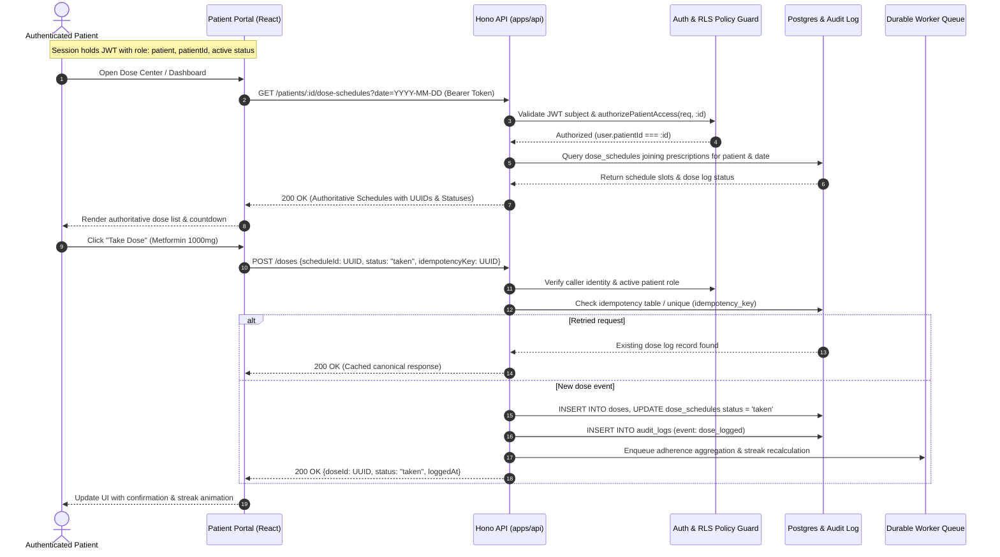

# Design: Patient Portal Backend Migration

## Context

See `proposal.md` for motivation. The backend foundation (`apps/api` built with Hono, `apps/worker`), database tables (`doses`, `dose_schedules`, `prescriptions`, `patient_consents`, `patient_preferences`, `visits`, `audit_logs`), and doctor portal workflows are established. In `complete-controlled-authentication`, we completed the 3-tier identity model (`auth.users` -> `public.profiles` -> `public.patients`).

The patient portal (`src/pages/patient/*`) currently interacts with some endpoints (`/reports`, `/patients/:id/prescriptions`) but still depends on static fixtures (`DEMO_PRESCRIPTIONS`, `DEMO_ADHERENCE`, `DEMO_SPARKLINE`, `DEMO_VISITS`, `DEMO_TRUST_COMPONENTS`) for schedules, computed adherence analytics, and transparency trust signals.

## Goals / Non-Goals

**Goals:**
- Provide typed, authorized Hono endpoints for patient daily dose schedules, live adherence aggregates, visits history, and consent management.
- Ensure idempotent dose logging using client request keys with server-recorded timestamps on `POST /doses`.
- Display verified, server-calculated adherence percentages and streaks without hardcoded fallbacks in backend-configured mode.
- Enforce strict patient-isolation security: patients can only access their own records (`auth.uid() === patient.profile_id` or `jwt.patientId === :id`).
- Maintain bounded development demo mode when backend environment variables are absent.

**Non-Goals:**
- Self-registration / sign-up flow without clinician invite (covered in clinical identity specification).
- Real-time WebRTC or messaging chat with clinicians (adherence messaging uses asynchronous care team notifications).
- Patient-initiated medication prescription creation (prescriptions strictly require doctor approval).

## Decisions

### 1. Daily Dose Schedule Resolution via Server Query
- **Decision**: Introduce dedicated endpoint `GET /patients/:id/dose-schedules?date=YYYY-MM-DD` that evaluates active prescriptions and `dose_schedules`, joining existing dose logs for that date.
- **Alternatives Considered**:
  - *Compute schedule client-side from prescription frequency*: Rejected because clinical adherence logic (e.g., missed window thresholds, grace periods, dose timings) must remain server-authoritative and synchronized between doctor and patient views.
  - *Pre-generate all future schedule rows in database*: Rejected as inflexible when prescriptions are adjusted or discontinued. Dynamic range resolution over active prescriptions and schedule slots is leaner and prevents orphan future records.

### 2. Client-Supplied Idempotency Key for Dose Events
- **Decision**: Enforce `idempotencyKey: string (min 8 chars, UUID recommended)` on `POST /doses`. The API validates `scheduleId: z.string().uuid()` and uses idempotency tracking to prevent duplicate doses across network retries.
- **Alternatives Considered**:
  - *Rely solely on schedule ID and date*: Disallows intentional multi-dose correction or late adjustment if needed. An explicit idempotency key guarantees safe retries across flaky mobile networks.

### 3. Server-Computed Adherence Aggregates and Streak Counts
- **Decision**: Expose `GET /patients/:id/adherence` returning rolling compliance rates (`takenPercentage`, `latePercentage`, `missedCount`, `currentStreakDays`, `trend`) computed dynamically from historical `dose_schedules` and `doses`.
- **Alternatives Considered**:
  - *Send all raw dose logs to the client and calculate in React*: Inefficient for patients with long histories; leaks internal log schemas and makes cross-platform metric calculation inconsistent.

### 4. Patient Isolation & Authorization Boundaries
- **Decision**: All patient endpoints enforce `authorizePatientAccess`:
  - `user.role === 'patient'` MUST have `user.patientId === req.params.id` AND `user.patientStatus === 'active'`.
  - Clinicians and admins can access if authorized.
  - Unauthorized queries return standard 403/404 without revealing record existence.
- **Audit Boundary**: Every dose mutation, consent toggle, and settings update writes an immutable record to `audit_logs` capturing `user_id`, `patient_id`, `action`, `metadata`, and `ip/user_agent`.

### 5. Explicit Bounded Fallback Architecture
- **Decision**: Preserve `isBackendConfigured()` guard in frontend API client. In development without backend, patient pages use localized mock snapshots (`todayDoses`, `DEMO_ADHERENCE`, etc.). When backend is configured, failures display actionable retry states and never silently fall back to demo numbers.

## Risks / Trade-offs

- **[Risk] Flaky mobile connections causing repeated dose button taps** → *Mitigation*: Client disables button on first tap and passes `crypto.randomUUID()` idempotency key; API deduplicates within transaction.
- **[Risk] Discrepancy between doctor dashboard adherence and patient dashboard adherence** → *Mitigation*: Both portals consume the exact same underlying adherence aggregate calculation service in `apps/api`.
- **[Risk] Patient toggling consent while clinical worker is processing a pipeline stage** → *Mitigation*: Worker re-verifies consent at execution time before dispatching reminders or sharing notes.

## Migration Plan

1. **Contracts & API Endpoints**: Add patient schedule, adherence, and transparency schemas in `@mednova/contracts`, implement endpoints in `apps/api/src/routes/patients/` and enhance `apps/api/src/routes/doses/`.
2. **Frontend Client & State Wiring**: Update `apiClient.ts` with typed methods, wire `DoseCenter.tsx`, `Dashboard.tsx`, `Visits.tsx`, `Transparency.tsx`, `Settings.tsx`, and `PatientShell.tsx`.
3. **Verification**: Run frontend integration tests, API contract tests, and end-to-end verification.
