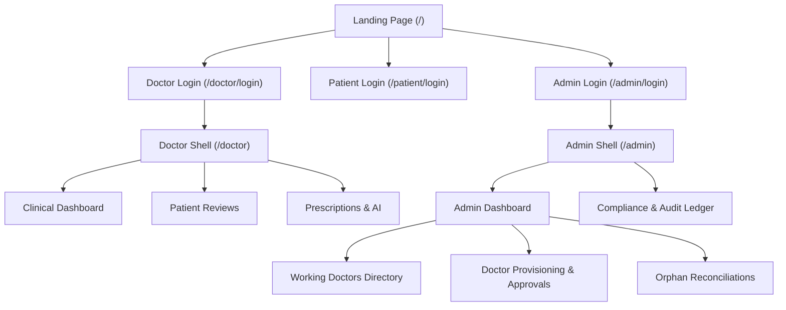

# Technical Design: Separate Admin Portal

## Context
See `proposal.md` for background and motivation. Administrative features currently reside in the doctor navigation hierarchy. The system already has backend API support for administrator-scoped endpoints (`/auth/doctor-invitations`, `/auth/reconcile-orphans`, `/audit`) gated by `requireRole("admin")`.

## Goals / Non-Goals

**Goals:**
- Provide a dedicated `/admin/login` page and `/admin` application shell.
- Completely remove administrative navigation elements and routes from the Doctor portal (`/doctor/admin/accounts`).
- Display all working/existing doctor profiles alongside pending invitations in the admin dashboard.
- Provide end-to-end management for doctor provisioning, approval/rejection, temporary credential issue, and orphan reconciliation.
- Preserve backward compatibility with Supabase Auth and database RLS.

**Non-Goals:**
- Allowing administrators to perform direct clinical actions (writing prescriptions, updating clinical dose records) without a doctor role.
- Redesigning patient-facing or doctor-facing clinical charts.

## Decisions

### 1. Extend `PortalRole` to Include `"admin"`
- **Decision**: Update `PortalRole` type definition in `apiClient.ts` to `"doctor" | "patient" | "admin"` and update `apps/api/src/routes/auth/index.ts` to allow `portal: "admin"` in `loginSchema`.
- **Rationale**: Clean separation of login contexts. Prevents patient or doctor tokens from unintentionally authenticating through the administrative gate.
- **Alternative considered**: Keeping `portal: "doctor"` for admins. Rejected because it violates least-privilege principles and creates confusing UI error messages.

### 2. Standalone Admin Shell (`src/components/admin/AdminShell.tsx`)
- **Decision**: Create a dedicated `AdminShell` component using a distinct, high-contrast dark indigo/slate theme with a clear "System Administrator" badge and navigation items (Physicians, Governance, Audit, Settings).
- **Rationale**: Visually signals that the user is in a high-privilege administrative mode, reducing accidental operational errors.

### 3. Integrated Admin Dashboard View (`src/pages/admin/AdminDashboard.tsx`)
- **Decision**: Organize the admin dashboard into clean tabbed/card views:
  1. **Physicians Roster**: Full list of active working doctors (name, email, role, approval status, credentials status).
  2. **Pending Approvals**: Fast-action cards to approve or reject new doctor applications.
  3. **Doctor Provisioning**: Modal to invite new doctors with temporary password options.
  4. **Data Integrity & Orphan Reconciliation**: Interactive table to scan and clean up orphaned records.
- **Rationale**: Gives administrators complete visibility and control over all clinical staff and database health in one unified place.

## Risks / Trade-offs
- **[Risk] Bookmarked URL Access**: Existing users who bookmarked `/doctor/admin/accounts` will hit a 404 or redirect.
  - *Mitigation*: Add an automatic redirect from `/doctor/admin/accounts` to `/admin` in `App.tsx`.
- **[Risk] Role Downgrade / Mismatch**: A doctor attempting to sign in at `/admin/login`.
  - *Mitigation*: The backend verifies `profile.role === "admin"`. If a doctor attempts to sign in at the admin portal, the API rejects it with `Invalid login credentials for this portal`.

## Migration Plan
1. Update API schema to allow `portal: "admin"`.
2. Implement `/admin/login`, `AdminShell`, and `AdminDashboard`.
3. Add redirect from `/doctor/admin/accounts` to `/admin`.
4. Remove admin links from `DoctorShell.tsx` and delete obsolete `src/pages/doctor/AdminDoctorManagement.tsx`.
5. Run automated unit tests and verify live login with `admin@mednova.clinic`.
